# Token Intelligence Layer — TIC Hackathon pitch deck

13 slides, 16:9 (1920 × 1080).

## Download

| File | Direct download |
| --- | --- |
| Presentation PDF (1.4 MB) | **[⬇ token-intelligence-layer-deck.pdf](https://github.com/TOVA2004/token-intelligence-layer-deck/raw/main/dist/token-intelligence-layer-deck.pdf)** |
| HTML presenter, works offline (1.3 MB) | **[⬇ token-intelligence-layer-deck.html](https://github.com/TOVA2004/token-intelligence-layer-deck/raw/main/dist/token-intelligence-layer-deck.html)** |
| Everything: PDF, HTML, slide images, source | **[⬇ Download ZIP](https://github.com/TOVA2004/token-intelligence-layer-deck/archive/refs/heads/main.zip)** |

Prefer to look first? [View the PDF in the browser](dist/token-intelligence-layer-deck.pdf).

<b>Slide preview</b>

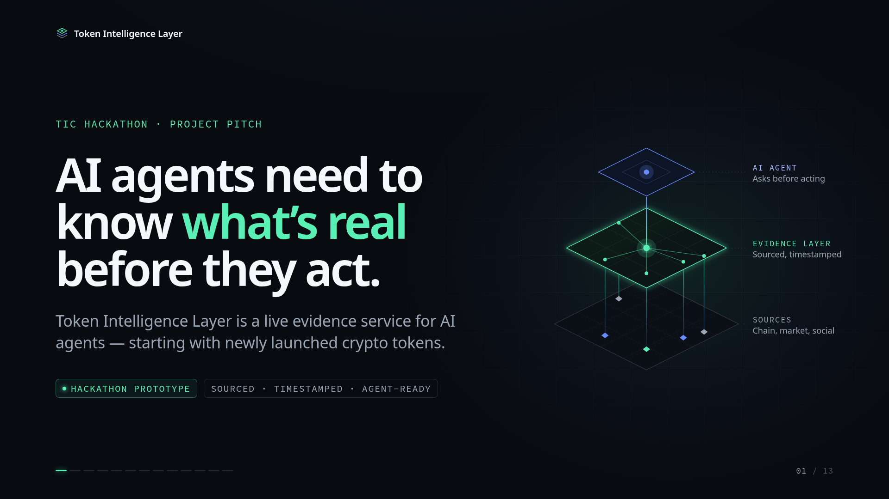
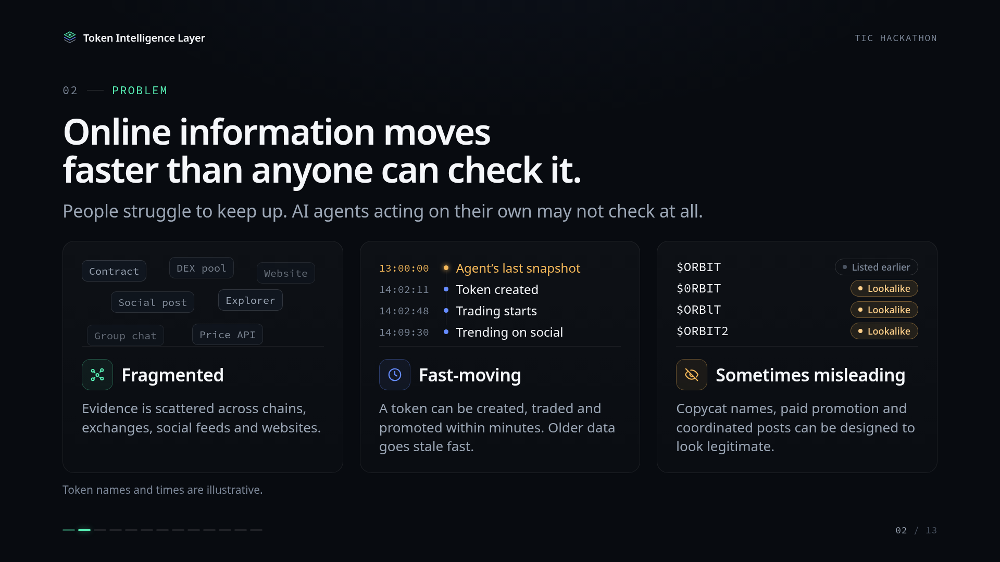
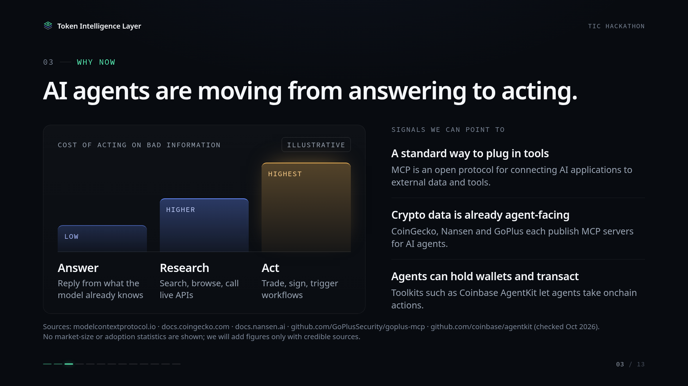
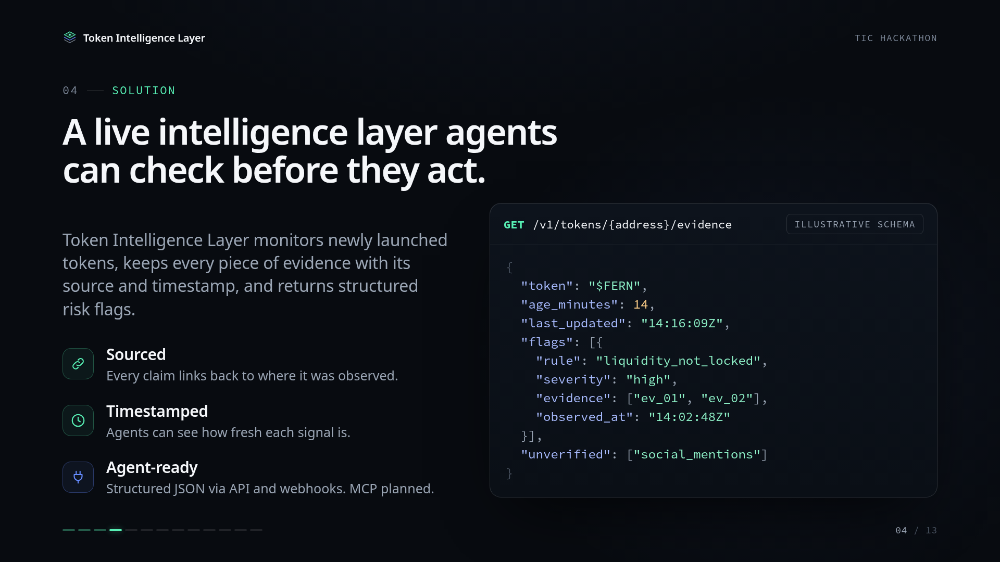
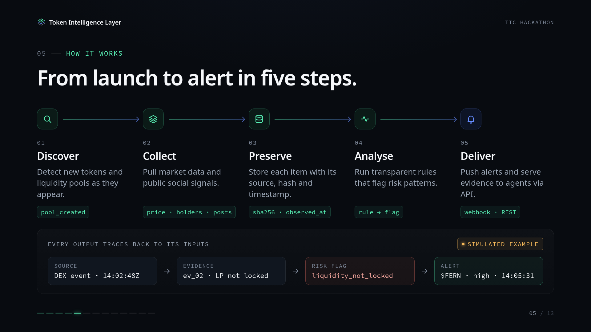
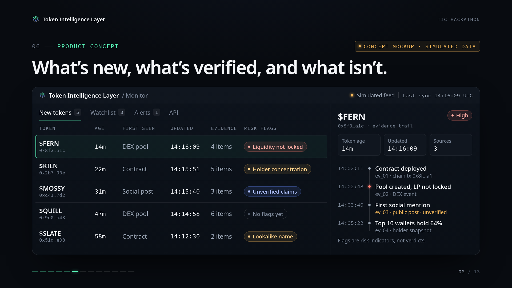
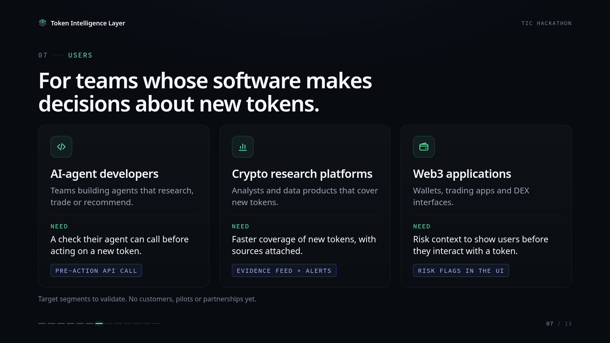
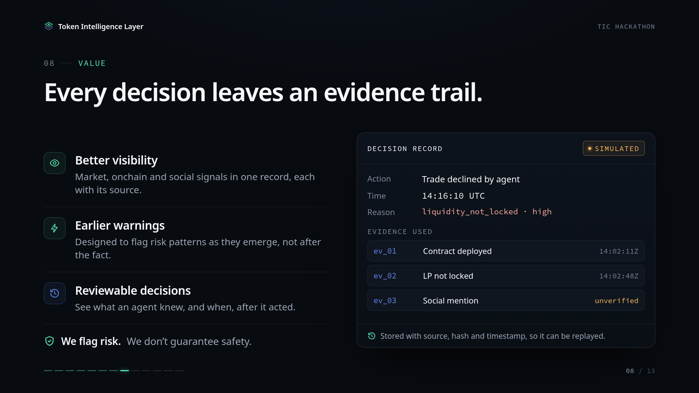
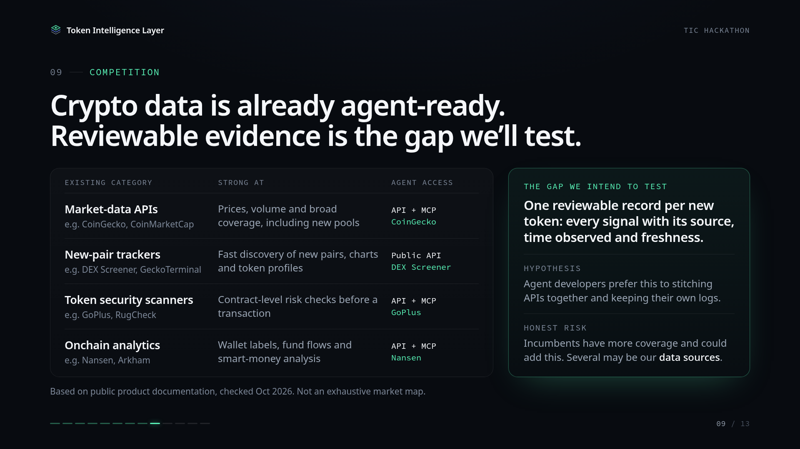
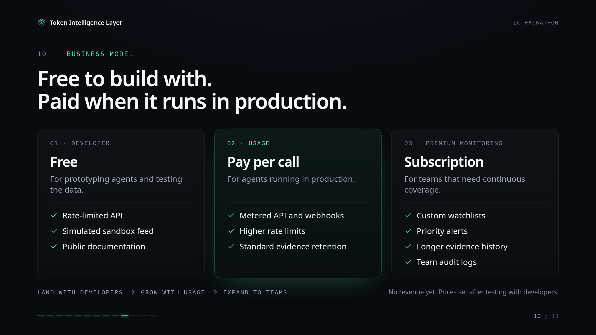
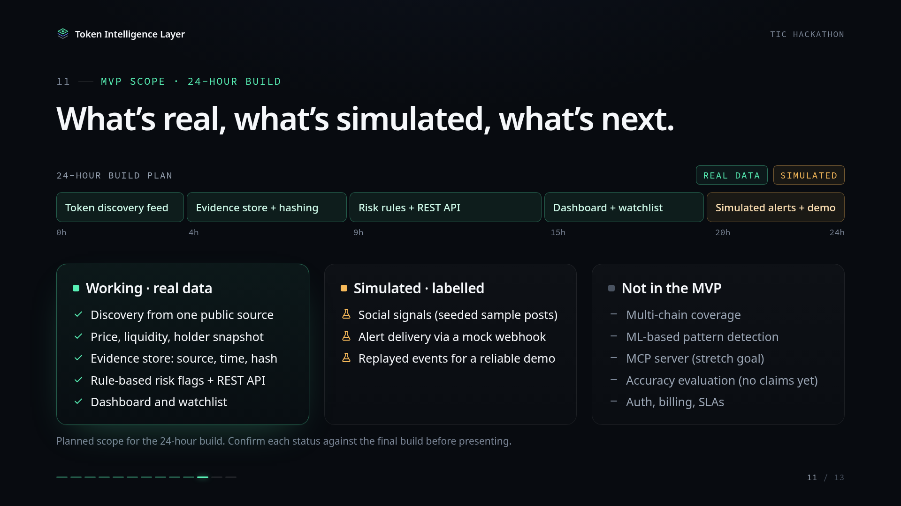
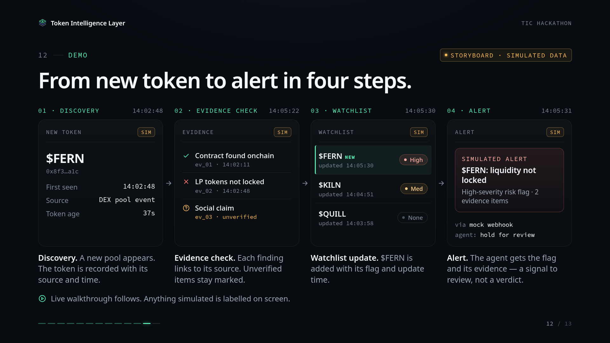
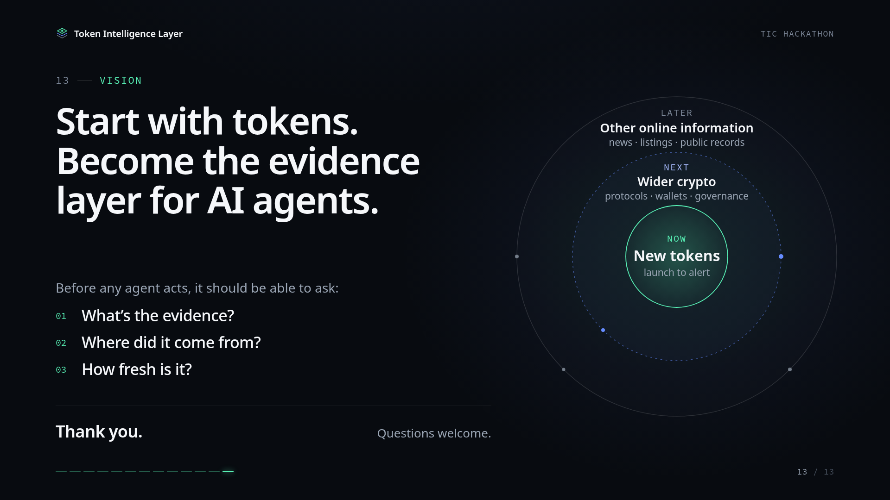

## Files

| File | Use |
| --- | --- |
| `dist/token-intelligence-layer-deck.pdf` | Presentation PDF, one slide per page |
| `dist/token-intelligence-layer-deck.html` | Self-contained presenter (fonts embedded; works offline) |
| `dist/png/slide-01.png … slide-13.png` | Slide images for Google Slides, Keynote or PowerPoint |
| `src/` | Editable source (`index.html`, `styles.css`, `deck.js`, `fonts/`) |
| `tools/build.py` | Rebuilds the single-file HTML from `src/` |

**HTML controls:** ← / → or Space to navigate · `F` fullscreen · `N` speaker notes · `#5` in the URL opens slide 5.
To make a PDF from the HTML, open it in Chrome, choose Print → Save as PDF, set margins to None and turn on Background graphics.

## Typography

The deck uses Inter when it can load from Google Fonts. If it can't, it falls back to the bundled Noto Sans (OFL). The PDF and PNGs were rendered offline, so they use Noto Sans. Source Code Pro (OFL) is the monospace font in both cases.

## Before presenting

- **Slide 11 (MVP scope):** these statuses are the planned scope. Make sure each item matches what actually works in the final build.
- **Slides 6, 8 and 12** are concept mockups and storyboards. All their data is simulated and labelled as such. Every token name, address and timestamp is fictional.
- No traction, customers, accuracy rates or revenue are claimed. Add market statistics only with a credible source.

## Sources (checked Oct 2026)

- Model Context Protocol — [modelcontextprotocol.io](https://modelcontextprotocol.io/specification/draft)
- CoinGecko MCP server — [docs.coingecko.com](https://docs.coingecko.com/reference/mcp-server); new-pools endpoint — [docs.coingecko.com](https://docs.coingecko.com/reference/latest-pools-list)
- DEX Screener public API — [docs.dexscreener.com](https://docs.dexscreener.com/api/reference)
- GoPlus Security MCP server — [github.com/GoPlusSecurity/goplus-mcp](https://github.com/GoPlusSecurity/goplus-mcp)
- Nansen MCP — [docs.nansen.ai](https://docs.nansen.ai/mcp/overview)
- Coinbase AgentKit — [github.com/coinbase/agentkit](https://github.com/coinbase/agentkit)
